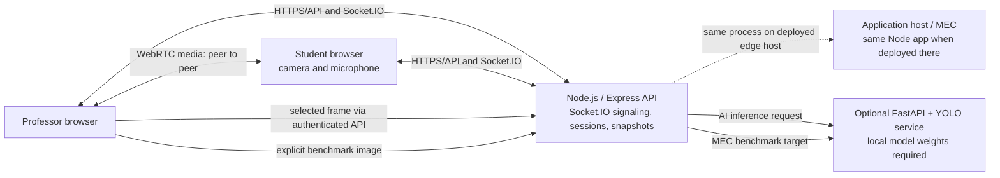

# Experiment execution guide

## A. Experimental setup

### Implemented architecture

The browsers exchange session and WebRTC signaling through Node.js/Express and Socket.IO; audio/video media is peer-to-peer between the browsers. The professor annotates the selected student stream, and ROI snapshots are shared through the session backend. Browser `RTCPeerConnection` statistics are WebRTC endpoint metrics. Separately, the MEC monitor measures browser-observed HTTP response time and periodic bounded transfers to the app backend. Those measurements become device-to-MEC-path measurements only when the app is hosted on the university edge and the browser reaches it over that network.

The optional AI path samples a reduced image from the professor's currently selected student stream, sends it through the authenticated backend, and invokes the FastAPI/YOLO service. The MEC benchmark sends only an image the professor explicitly chooses to the configured MEC inference service.

**Not part of the current implementation:** Ethernet IP camera/MediaMTX ingest, ONVIF discovery, an SFU, TURN relay configuration, 5G radio/air-interface KPIs, and an installed university MEC server. The current project supports student browser camera/microphone feeds. Deployment templates exist, but they have not been installed on the college server.

### Hardware and software

- **Student device:** browser, webcam, microphone, and network connection.
- **Professor device:** browser and network connection. For a local two-role demonstration, use two separate browser profiles on one laptop; separate physical devices provide a more realistic test.
- **Application backend:** existing Node.js/Express/Socket.IO app. Locally it runs on the laptop. In a college deployment, the prepared Linux/Nginx configuration is intended to place it on the MEC/edge host.
- **WebRTC:** browser-to-browser media; signaling uses the backend. Current browser ICE configuration includes STUN but no TURN service.
- **MEC monitoring:** authenticated HTTP probes and bounded transfer endpoints in the application backend. This is not radio instrumentation.
- **Optional AI:** Python FastAPI, requirements in `ai-service/requirements.txt`, and a locally installed generic YOLO COCO weight file. The current workspace lacks the Python dependencies and model weights.
- **IP camera/MediaMTX:** not present; do not include it in this experiment.

### Test setup choices

| Setup | What it can demonstrate | Limits |
|---|---|---|
| One laptop, two browser profiles | UI, role logins, session signaling, local WebRTC if the browser/OS permits two webcam captures, annotations and shared snapshots | One webcam may be exclusive to one profile; this is not a multi-device or 5G test |
| Separate physical devices on a local network | Independent cameras/microphones, peer connection and browser metrics | Non-local camera access normally needs a trusted HTTPS site; current Vite HTTP mode is for local development |
| Device on actual 5G with app hosted at college edge | Real device-to-edge HTTP path and peer connectivity, if firewall/routing permit | Project does not measure 5G radio KPIs or prove traffic uses a particular radio slice |
| University MEC VM | Deployment and device-to-edge path after DNS, TLS, firewall, service account and secrets are provisioned | No college VM has been configured or tested in this work |
| Physical Ethernet IP camera | Nothing in current app; camera ingest is not implemented | No camera or MediaMTX service is included |

## B. Experiment execution

### 1. Start the services

Follow [LOCAL_EXECUTION_GUIDE.md](LOCAL_EXECUTION_GUIDE.md). Start the Node backend and Vite frontend using the root launcher. Start the optional AI service separately only after compatible dependencies and approved model weights are installed.

### 2. Open the application

Open <http://localhost:5180>. Check that the page loads and that `http://localhost:3101/health` reports `status: ok`. If using another port, use the values set in `server/.env` and `client/.env.local`.

### 3. Register and log in as professor

In browser profile A, choose **Register device**, choose the professor role, enter a unique email/display name/password, and the local professor enrollment key. Sign in using the same profile. Expected: the signed-in account role is shown and professor session controls are available. A failed enrollment-key response usually means the role key in `server/.env` is empty or does not match.

### 4. Register and log in as student

In a separate browser profile, register a student using a different email and the student enrollment key, then sign in. Each profile has its own browser device ID. Expected: the student session-code form appears. Do not use two tabs in the same profile as a substitute for two accounts; session storage is shared within that profile.

### 5. Create and join a laboratory session

As professor, choose **Create session** and share the displayed 32-character code with the test student. As student, enter that code and choose **Join session**. Expected: both show an active session and the participant list updates. The backend enforces one professor and up to three active students per room.

### 6. Establish live video

As student, allow camera/microphone permissions and choose **Enable camera and microphone**. Expected: the student sees the local preview and the professor sees the student stream/participant tile after the WebRTC connection completes. If signaling succeeds but video does not connect, check device permissions, browser console, firewall/NAT restrictions, and whether a TURN relay is needed. The current project has no TURN configuration.

### 7. Demonstrate live annotations

On the professor page, select the student's feed and use **Start drawing**, draw over the main live video, and then **Stop drawing**. Use **Clear drawings** to clear the annotation. Expected: annotations are relayed to the session and appear in the other participant view. If the canvas does not respond, confirm the remote video is active and that the professor is in the same session.

### 8. Select an ROI and share a snapshot

On the professor page, choose **Capture region**, drag a rectangle over the live video, and release. Expected: the crop is sent to the shared workspace. It should appear as a snapshot/ROI for both session members. In the workspace, demonstrate adding notes/annotations or switching versions if desired. A missing snapshot can indicate the video is not ready or the socket/session disconnected.

### 9. Demonstrate WebRTC network monitoring

Scroll to **Network quality** on a joined-session page. Observe the peer card update. Available fields include RTT, jitter, packet loss, bitrate, FPS, resolution, connection state, and adaptive profile; some fields can show unavailable depending on browser statistics. These are peer-to-peer WebRTC statistics, not MEC HTTP or radio measurements.

### 10. Demonstrate adaptive video

On the student page, leave **Adaptive video** enabled. Select **High**, **Medium**, or **Low** under **Fallback profile** and choose **Apply profile**. Expected: a notice reports whether the current browser accepted `RTCRtpSender.setParameters()`. Automatic adaptation requires repeated poor samples before reducing quality and sustained good samples before recovering; a good localhost call may remain at High. A change in encoder quality requires a real browser session and suitable network conditions. Do not claim a step-down unless the UI/profile and peer statistics show it.

### 11. Demonstrate AI detection (optional)

Perform this step only if the AI service health check succeeds and a local YOLO weights file is installed. With the student stream active, start **AI object assistance** in the professor view. Expected: detections, confidence, boxes and inference duration appear; **Capture suggested ROI** sends a detection crop to the shared workspace. If dependencies/weights are absent or inference fails, report AI as unavailable; a health response alone does not prove weights load. Labels are generic COCO detections, not lab-specific or safety alarms.

### 12. Demonstrate implemented MEC-path monitoring

Scroll to **5G & Edge monitoring**. Leave monitoring enabled for at least six probes to allow a transfer sample. Expected: the panel shows browser-observed HTTP RTT/API duration, probe availability, and periodic estimated throughput from a 64 KiB upload and download. On this laptop-local setup these values describe the localhost path. On a deployed edge host they describe the browser-to-app path. Neither run demonstrates 5G radio latency, one-way delay, packet loss on the radio path, network slicing, or QoS.

### 13. Demonstrate MEC inference benchmarking (conditional)

As professor, join a session and open **MEC inference benchmark**. Select a PNG/JPEG/WebP image under 750 KiB and choose 3, 5, or 10 samples. Run only if the MEC inference service is configured and available. Results separate total browser response, backend-to-endpoint request time, and processor-reported inference time. The current local configuration has the AI URL configured but the AI process is unavailable; expect unavailable/failure states until the service is started. Do not present blank or failed results as measurements.

### 14. Show final results and limitations

Show the active session, live stream, shared ROI, WebRTC network card, and MEC monitor. If AI or benchmark endpoints are configured, show their actual outputs. State whether the test was localhost, a LAN, or a university edge connection. State clearly that this workspace has not been validated on actual 5G or the college MEC VM.

There is no IP-camera step: Ethernet IP camera/MediaMTX integration was removed and is not part of this project version.

## C. Expected evidence to retain

- A screenshot/recording of both roles joined to the same session and the student stream visible.
- Annotation and resulting shared ROI snapshot visible in the workspace.
- WebRTC metrics with units and the selected/adaptive profile.
- MEC panel after at least six probes; label the measured route (localhost, LAN or edge).
- AI/benchmark outputs only when their service is actually available. Preserve the unavailable state if it is the genuine outcome.
- Do not edit or manufacture metrics. Record device/browser, connection type, endpoint location, number of sessions, and whether the AI/MEC inference service was configured.

## D. What each setup validates

The backend suite validates authentication/authorization, session capacity/isolation, snapshot sharing and persistence, WebRTC signaling/metrics relay, MEC endpoints, audit secrecy, and health behavior. Frontend unit tests validate WebRTC metric calculations, adaptive policy, benchmark summaries, and detection-box geometry. They do not establish that two physical browsers negotiated media, a camera stayed available, or a university network routed over 5G. Those require live browser/device and network tests.
